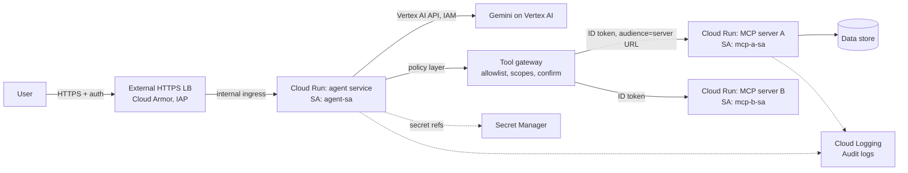

# Architecture

## Components

## Trust boundaries
1. **Internet to edge:** untrusted users. Terminate TLS at the load balancer, authenticate (for example IAP or your IdP), apply Cloud Armor rules and rate limits.
2. **Edge to agent:** the Cloud Run service accepts traffic only from the load balancer (internal and load-balancer ingress) and requires authenticated callers.
3. **Agent to model:** model output is untrusted. The model can request actions; it cannot grant itself authority.
4. **Agent to tools:** crossing from "model proposes" to "system acts". This is the main control point (see [mcp-tool-access.md](mcp-tool-access.md)).
5. **Tools to data:** each MCP server has its own identity and least-privilege access to its own data only.

## Design principles
- **Least privilege per identity.** Agent, each MCP server, and the CI deployer have separate service accounts.
- **Keyless.** Use the attached service account and Application Default Credentials. No downloaded service account keys.
- **Authorization outside the model.** Checks are enforced in code and IAM, not in prompts.
- **Private by default.** Cloud Run services are not publicly invokable; callers need `roles/run.invoker`.
- **Controlled egress.** Route outbound traffic through a VPC with Private Google Access and an egress allowlist so a compromised agent cannot freely exfiltrate.
- **Reproducible and signed builds.** Build in CI, store in Artifact Registry, deploy by digest, optionally enforce with Binary Authorization.
- **Observable.** Structured logs with request ID and caller identity, Cloud Audit Logs for admin and data access.

## Request flow
1. User authenticates at the edge; the verified identity is passed to the agent.
2. Agent builds the prompt from the system instructions, user input, and retrieved context. Retrieved content is marked as untrusted data.
3. Agent calls Gemini via Vertex AI using its own service account.
4. If the model proposes a tool call, the policy layer checks: is this tool allowed for this user and agent, are the arguments valid, does it need confirmation.
5. The gateway calls the MCP server with a Google-signed ID token whose audience is that server, so the server can verify the caller.
6. Result returns as untrusted data. Output is validated and encoded before display.
